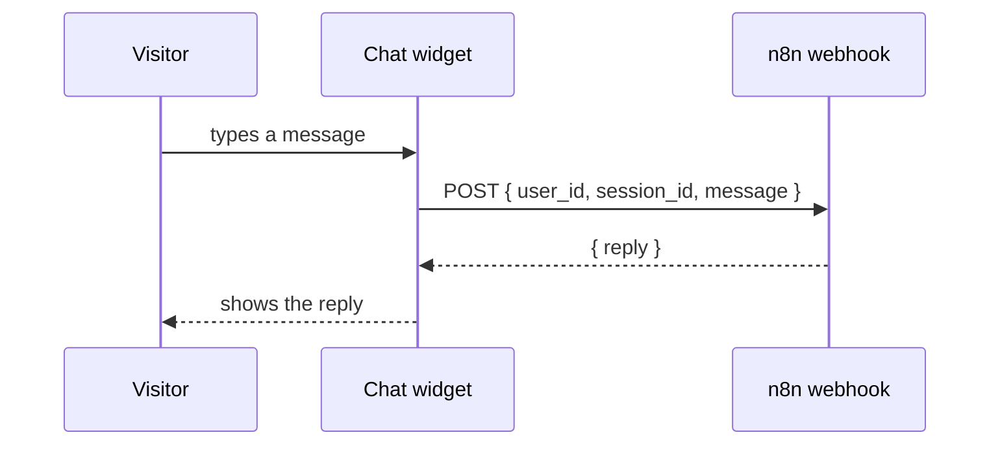

# Front Desk Receptionist: AI Chat Widget

A lightweight chat widget that puts an AI receptionist on any clinic website. It's one HTML file with no framework and no build step: copy the widget block into a page and point it at an n8n webhook.

This is the front end of my [AI Clinic Receptionist](https://github.com/harishameedqazi/ai-clinic-receptionist) project, which handles the AI answers, calendar booking and logging.

## Features

- Floating chat bubble that opens a chat window
- Typing indicator while the AI is answering
- Keeps a session ID per visitor so the backend can remember the conversation
- Friendly error message if the backend is down, instead of a broken chat
- Embeds on any site: paste the block between `NOVATECH WIDGET START` and `NOVATECH WIDGET END` before `</body>`

## How it works

## Setup

1. Open `index.html`.
2. Set `N8N_WEBHOOK_URL` to your n8n webhook URL.
3. Open the page in a browser and click the bubble in the bottom-right corner.

The demo uses a made-up dental clinic ("NovaTech Dental"). Change the name, colours and greeting in the file.

## Stack

HTML · CSS · vanilla JavaScript · n8n
